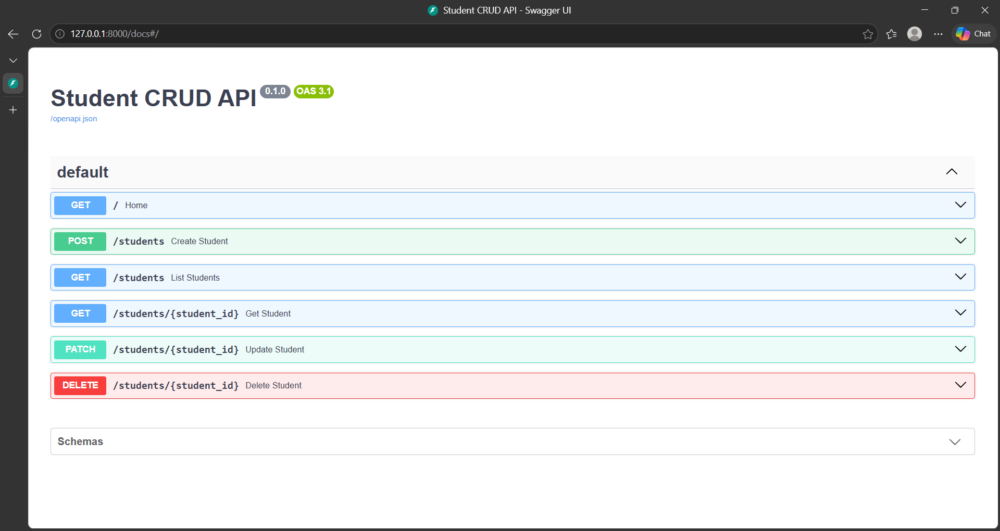
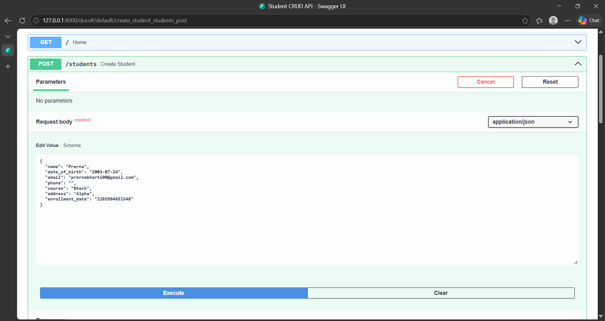
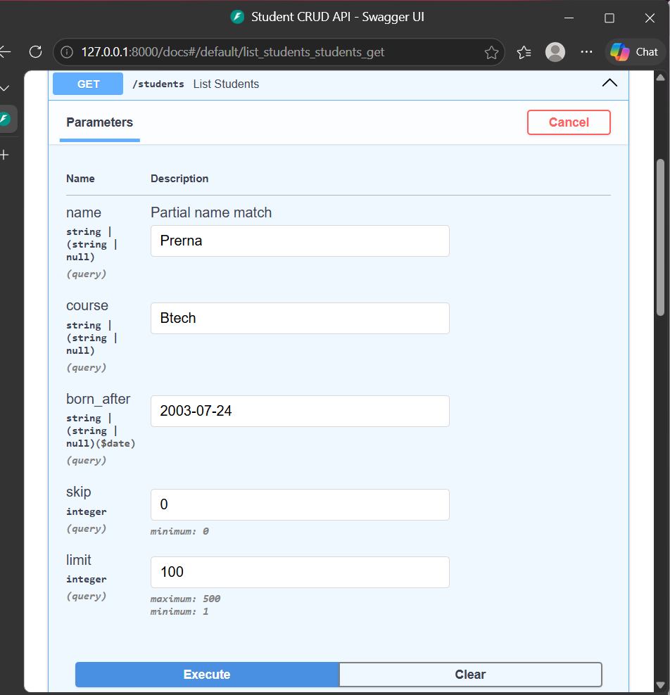
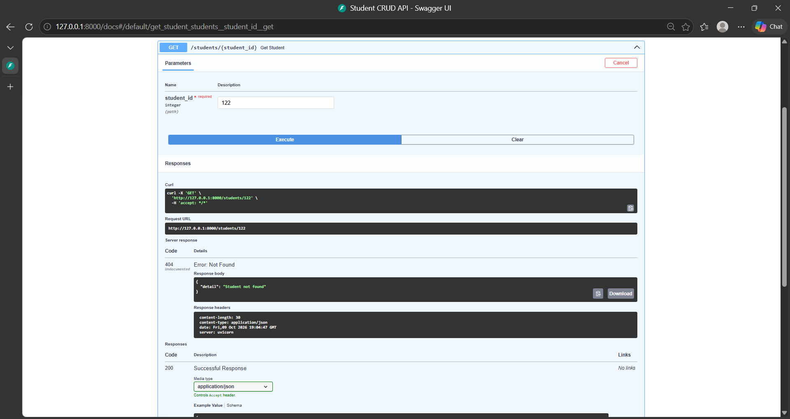
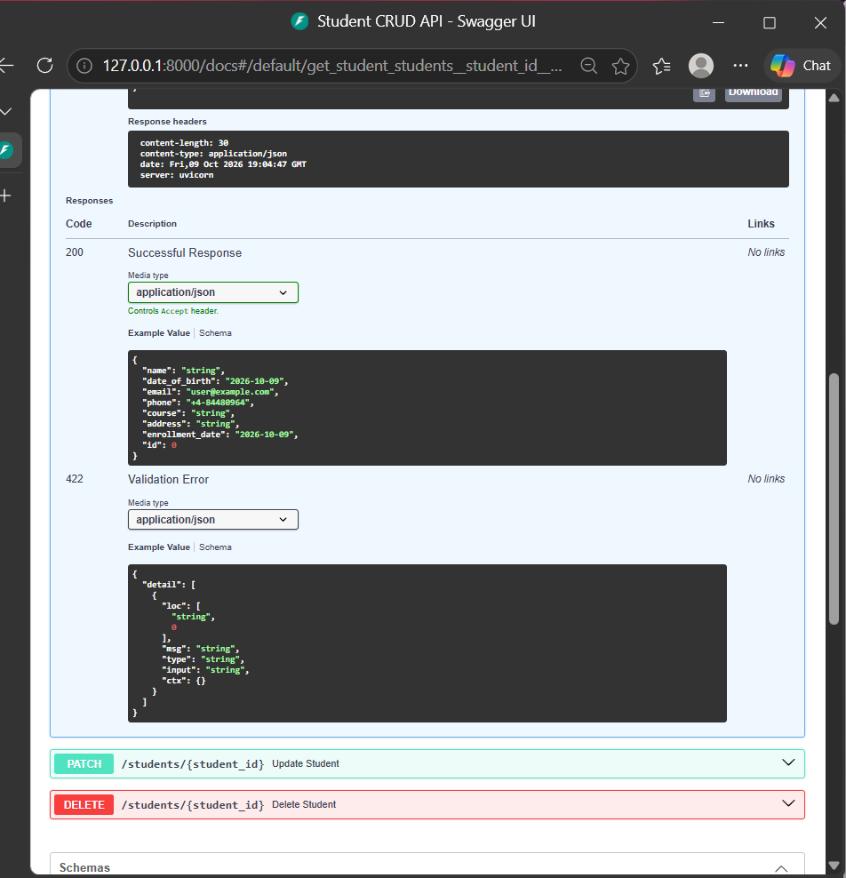

# Student CRUD API (FastAPI + SQLite)

A backend application to manage student records using Create, Read, Update and Delete operations.

## Prerequisites

-Python 3.9 or higher

## Installation

```bash
python -m venv venv
venv\Scripts\activate
pip install -r requirements.txt
```

## Run

```bash
python -m uvicorn main:app --reload
```

Open http://127.0.0.1:8000/docs for the Swagger UI. The file `students.db` is created automatically.

## API Endpoints

| Method | Endpoint | Purpose |
|---|---|---|
| POST | /students | Create a student |
| GET | /students | List / filter (name, course, born_after) |
| GET | /students/{student_id} | View a student |
| PATCH | /students/{student_id} | Update details |
| DELETE | /students/{student_id} | Delete a student |

## Validation

- name and date_of_birth are required
- At least one of email or phone is required
- Email must be valid and unique (409 if duplicate)
- Unknown student ID returns 404

##Screenshots

### 1. Swagger UI - API Endpoints



### 2. Create Student - POST /students



### 3. List Students - GET /students



### 4. Error Handling



### 5. Input Validation



